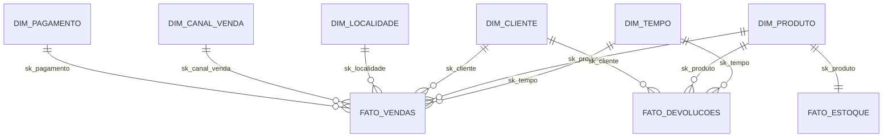

# Data Warehouse de Eletrônicos
 
Data Warehouse construído do zero a partir de CSVs de **vendas**, **estoque** e **devoluções** de uma operação de eletrônicos. Os dados passam por três camadas (`raw` → `staging` → `dw`) e chegam a um modelo dimensional (Star Schema) pronto para análise.
 
## Arquitetura
 

 
| Camada | Função |
|---|---|
| **raw** | Dados exatamente como chegam, sem chaves e sem transformação. Permite reprocessar sem perder o original. |
| **staging** | Dados limpos e padronizados, com chaves primárias que impedem duplicidade. |
| **dw** | Modelo dimensional com fatos e dimensões, voltado para análise. |
 
## Modelo dimensional
 

 
- **Fatos:** `fato_vendas`, `fato_devolucoes`, `fato_estoque`
- **Dimensões:** `dim_tempo`, `dim_produto`, `dim_cliente`, `dim_localidade`, `dim_canal_venda`, `dim_pagamento`
- **Chaves surrogadas (`sk_`)** identificam os registros das dimensões; as chaves naturais (`pedido_id`, `cliente_id`...) vêm da origem.
- **`dim_tempo`** é um calendário contínuo (do primeiro ao último ano dos dados), com nomes de meses e dias em português.
## Decisões de projeto
 
- **Três camadas:** isolam o dado bruto, o tratamento e o consumo. Se algo der errado, dá para reprocessar a partir da camada anterior.
- **Procedures SQL:** a lógica de transformação fica no banco, é reutilizável e executada em ordem por uma procedure principal (`dw.sp_run_dw`): dimensões primeiro, fatos depois.
- **UPSERT (`ON CONFLICT`):** o pipeline pode ser executado várias vezes sem duplicar dados (carga idempotente).
- **Tratamentos na staging:** `TRIM`, `COALESCE` (desconto e frete vazios viram zero), `UPPER`/`INITCAP`, `ROUND`, `EXTRACT` (ano e mês) e conversão de texto para `DATE`.
## Resultado
 
| Tabela | Registros |
|---|---|
| `stg_vendas` / `fato_vendas` | 3.000 |
| `stg_devolucoes` / `fato_devolucoes` | 210 |
| `stg_estoque` / `fato_estoque` | 12 |
 
<!-- Adicione aqui um print do modelo no DBeaver (ER Diagram) -->
 
## Stack
 
Python · PostgreSQL · SQLAlchemy · SQL (PL/pgSQL) · DBeaver
 
## Como executar
 
```bash
python3 -m venv venv
source venv/bin/activate
pip install -r requirements.txt
```
 
Crie um `.env` na raiz (não versione):
 
```dotenv
DB_HOST=localhost
DB_PORT=5433
DB_NAME=dw_eletronicos
DB_USER=postgres
DB_PASSWORD=sua_senha
```
 
```bash
python3 scripts/teste_conexao.py   # valida a conexão
```
 
```sql
CALL dw.sp_run_dw();               -- carrega dimensões e fatos
```
 
## Desafio: PostgreSQL no WSL
 
A conexão do Python falhava com `Connection refused`: o banco estava no Windows e o código rodava no WSL, onde `localhost` aponta para o próprio Linux. Como o Windows 10 não tem rede espelhada, a solução foi instalar o PostgreSQL dentro do WSL, na porta 5433 (evitando conflito com a instância do Windows), e atualizar o `.env`.
 
## Aprendizados
 
- Separar em camadas permite reprocessar sem perder o dado original.
- UPSERT torna o pipeline idempotente.
- Chave natural vem da origem; chave surrogada é criada pelo DW.
- Um calendário contínuo é pré-requisito para análises de tempo.
 
